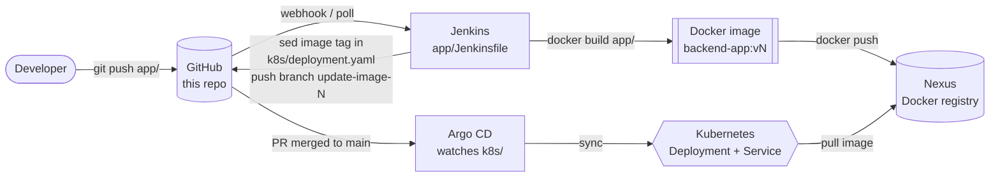

# springboot-gitops-jenkins-argocd

An end-to-end **GitOps CI/CD** lab for a Spring Boot service. Jenkins builds and tests it, packages it as a Docker image, and pushes it to a **Nexus** Docker registry. It then bumps the image tag in the Kubernetes manifests, and **Argo CD** syncs the change to the cluster.

It also includes a second, simpler Jenkins pipeline that builds a Maven artifact and publishes it to a Nexus **Maven** repository.

This repo combines three earlier repos (`applicationcode`, `manifests`, `jenkins_springboot_nexus`), with their commit history kept.

## Flow



1. A push to `app/` triggers the **app** pipeline.
2. Jenkins builds the image from `app/Dockerfile` (multi-stage: Maven 3.9 / Temurin 17 build → Temurin 17 JRE runtime) and tags it `v<BUILD_NUMBER>`.
3. Jenkins pushes the image to the Nexus Docker registry at `REGISTRY_HOST`.
4. Jenkins clones this repo, rewrites the `image:` line in `k8s/deployment.yaml`, and pushes a branch `update-image-<BUILD_NUMBER>`.
5. When that branch is merged to `main` (via a PR), Argo CD, watching `k8s/`, applies the new Deployment, and the cluster pulls the new image from Nexus.

## Repository layout

| Folder | What it is |
|---|---|
| [`app/`](app) | Spring Boot 3.2 / Java 17 REST service (`backend-app`, port **8084**), its `Dockerfile`, unit tests, and the GitOps pipeline [`app/Jenkinsfile`](app/Jenkinsfile) |
| [`k8s/`](k8s) | Plain Kubernetes manifests that Argo CD deploys: a 2-replica `Deployment` (with `imagePullSecrets: nexus-registry-credentials`) and a `NodePort` `Service` (80 → 8084) |
| [`nexus-maven-pipeline/`](nexus-maven-pipeline) | A separate Hello World Spring Boot app and [`Jenkinsfile`](nexus-maven-pipeline/Jenkinsfile): checkout → compile → test (JUnit report) → package (archive jar) → upload jar + POM to Nexus `maven-snapshots` / `maven-releases` with the *Nexus Artifact Uploader* plugin → `mvn verify` |

## Endpoints

**`app/` (backend-app, port 8084)**

| Path | Response |
|---|---|
| `GET /hello` | Greeting message |
| `GET /health` | `UP` |
| `GET /info` | App name and version |

**`nexus-maven-pipeline/` (port 8080)**: `GET /` returns *Hello World*, and `GET /health` returns a running message.

## Running it in a lab

### 1. Run the app locally

```bash
mvn -f app/pom.xml test
mvn -f app/pom.xml spring-boot:run          # or:
docker build -t backend-app:dev app && docker run -p 8084:8084 backend-app:dev
curl localhost:8084/hello
```

### 2. Nexus

- Run Nexus 3 (for example with [helm-charts-devops-toolchain](https://github.com/suhaib-md/helm-charts-devops-toolchain), or `docker run -p 8081:8081 -p 5000:5000 sonatype/nexus3`).
- Create a **docker (hosted)** repository with an HTTP connector on port `5000`. That address is your `REGISTRY_HOST`.
- For the Maven pipeline, the default `maven-releases` / `maven-snapshots` repos are used.
- The registry is plain HTTP, so add it to `insecure-registries` on the Jenkins Docker daemon and on the cluster nodes' container runtime.

### 3. Jenkins

Plugins: Pipeline, Git, Docker Pipeline, Credentials Binding, JUnit, Nexus Artifact Uploader, Workspace Cleanup.

Create these credentials. The IDs are referenced in the Jenkinsfiles and marked `TODO`:

| ID | Type | Used by |
|---|---|---|
| `nexus-docker-credentials` | Username with password | `app/Jenkinsfile`: docker push |
| `github-token` | Secret text (GitHub token with `contents:write` on this repo) | `app/Jenkinsfile`: push the image-bump branch |
| `nexus-credentials` | Username with password | `nexus-maven-pipeline/Jenkinsfile`: artifact upload |

Create two Pipeline jobs, both *Pipeline script from SCM* pointing at this repo:

- **backend-app-gitops**: Script Path `app/Jenkinsfile`, parameter `REGISTRY_HOST` (e.g. `nexus.lab.local:5000`)
- **nexus-maven-pipeline**: Script Path `nexus-maven-pipeline/Jenkinsfile`, parameter `NEXUS_URL` (default `localhost:8090`), with Maven `Maven-3.9.0` and JDK `OpenJDK-17` configured under *Global Tool Configuration*

The image-bump commit only touches `k8s/` and includes `[skip ci]`. Also limit the app job to changes under `app/`, for example with *Additional Behaviours → Polling ignores commits in certain paths → Included regions: `app/.*`*, so the bump doesn't re-trigger the build.

### 4. Kubernetes + Argo CD

```bash
# pull secret for the Nexus registry, used by k8s/deployment.yaml
kubectl create secret docker-registry nexus-registry-credentials \
  --docker-server=<REGISTRY_HOST> --docker-username=<user> --docker-password=<password>
```

Set the `image:` registry in `k8s/deployment.yaml` to your `REGISTRY_HOST` (the placeholder is `registry.example.com:5000`), then register the app with Argo CD:

```yaml
apiVersion: argoproj.io/v1alpha1
kind: Application
metadata:
  name: backend-app
  namespace: argocd
spec:
  project: default
  source:
    repoURL: https://github.com/suhaib-md/springboot-gitops-jenkins-argocd.git
    targetRevision: main
    path: k8s
  destination:
    server: https://kubernetes.default.svc
    namespace: default
  syncPolicy:
    automated: { prune: true, selfHeal: true }
```

```bash
kubectl get svc backend-service     # NodePort -> http://<node-ip>:<nodePort>/hello
```

## Tech

Java 17 · Spring Boot 3.2 · Maven · Docker (multi-stage) · Jenkins declarative pipelines · Sonatype Nexus 3 (Docker + Maven repos) · Kubernetes · Argo CD
